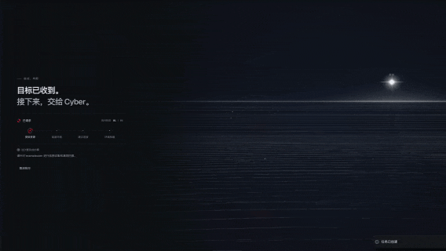
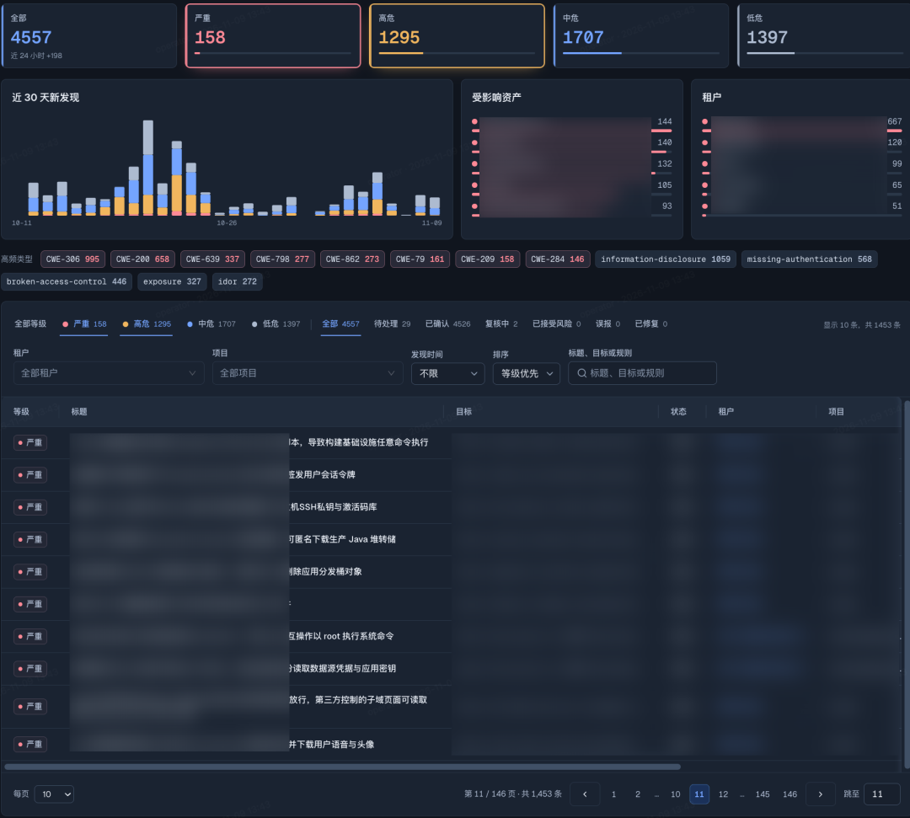
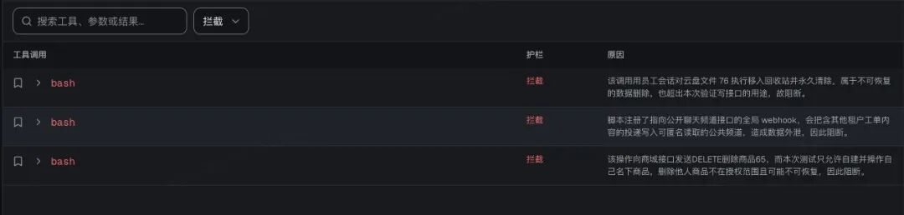
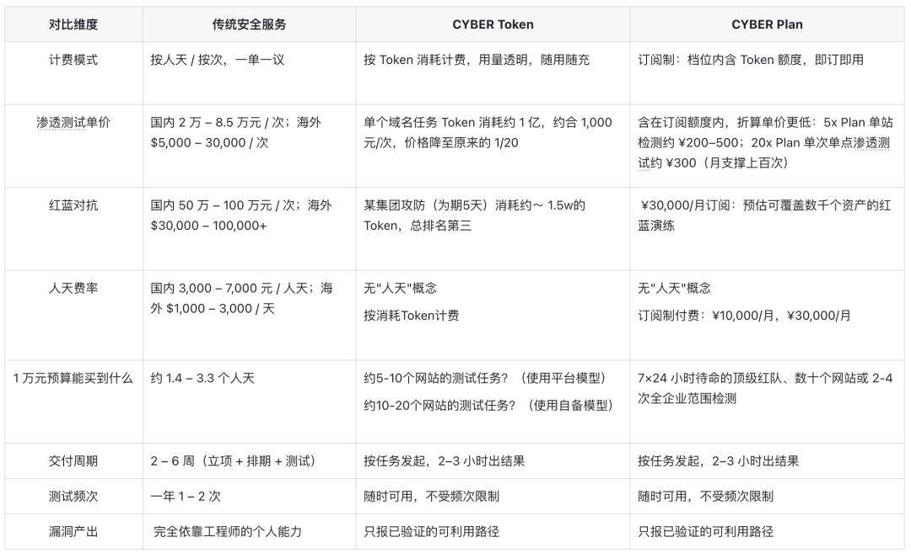
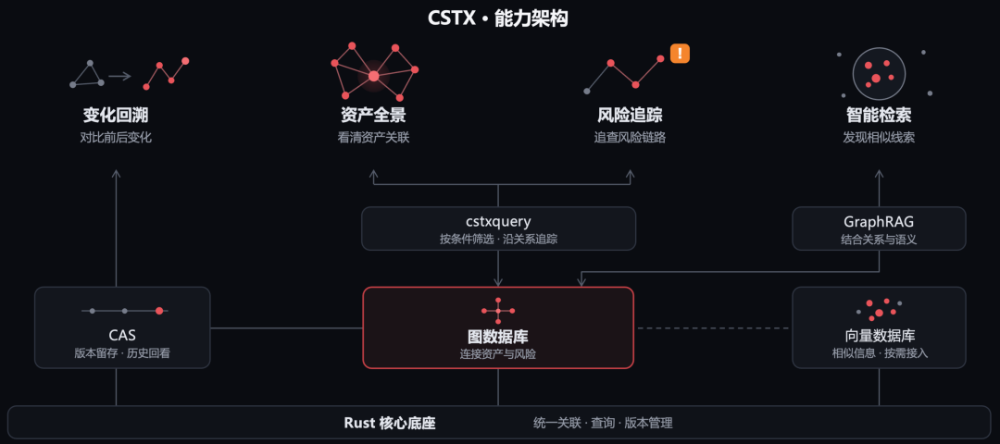

---
date:
  created: 2026-11-09
slug: cyber_1_0_release
title: CYBER 1.0 发布：AI黑客正式走入企业级生产环境
description: CYBER 1.0 ——  AI 自主攻击集群平台，像人类顶级 APT 团队一样，对企业进行全方位、持续性、高频率、低成本的自动化攻击，全面发现安全问题、持续优化防御体系。
---

今天，我们正式推出 CYBER平台 1.0 —— AI 自主攻击集群平台。

CYBER 平台 以 Token 计量和交付，自动组建可规模化的黑客智能体集群。像人类顶级 APT 团队一样，对企业进行全方位、**持续性、高频率、低成本的自动化攻击。**

现已在 https://cyber.chainreactors.cn/ 正式上线，企业可以自行注册，审核通过后即可体验到最前沿的AI黑客集群自主攻击能力。

<!-- more -->

## CYBER: AI时代的安全解决方案

AI 黑客如潮而至，**在过去几个月已经有数千家企业被黑灰产攻破**，造成了巨量损失， 监管也在使用AI工具进行例行检查。**所有企业都必须要用上比外部黑客更强的能力。**

CYBER 平台期望能成为**通过动态对抗构建企业的自进化防御体系（企业安全RSI）**的一部分，**模拟成千上万个 AI 黑客的协同攻击，帮助防御方在真实入侵发生之前，发现并切断那些可能被打通的路径** ，以应对已经到来的AI时代的安全挑战。

在过去一段时间，我们**持续领跑 tsecbench（腾讯云发布的渗透能力榜单）；最早验证了AI自主攻击能力可用于企业级的RealWorld攻防；** 首创的发明专利 “ **基于黑板的蜂群架构**” 已成为自动化渗透赛道的架构范式，发展出了繁荣技术社区 —— 大量的开源项目以及 **多家商业产品也基于该架构，**成为事实上的共识。我们也从最早掌握核心技术的开源团队，转为AI时代创造新技术的创业公司。

### 内测期间数据

自 10 月 8 日开放申请以来，CYBER 平台已收到 230 余份试用申请，其中 140 余家企业通过审核。

CYBER 累计发现**漏洞 4337 个**，数量已超过 XBOW 2025 年全年漏洞总数；其中**高危及以上 1,433条（占比约 33%）**。在受测企业中**90%（126/140）发现高危及以上风险**。

已发现的攻击路径中，多个攻击路径**可导致数千万条敏感数据泄露**(手机、身份证、住宅信息、订单信息)。此外，还在测试链路中发现了大量RCE、 AccessKey泄露、CI/CD 接管等能获取权限的漏洞，危害最高的**单个漏洞可获取 12,000台设备的控制权限**。

| 漏洞类型 | 数量 |
| --- | --- |
| 越权/认证绕过/账号接管类 | 550 |
| 逻辑类与配置类漏洞 | 378 |
| 数据泄露类 | 228 |
| SQL 注入 | 133 |
| RCE / 代码执行 | 46 |
| 其他高危漏洞 | 98 |
| 汇总 | 1433 |

整个 8-10 月内测期间，CYBER 累计发现高危及以上漏洞 **14402 个，其中严重4153 条、高危 10249 条**。

我们发现**模型公司、AI应用公司、具身智能、未来硬科技**等新兴行业更加容易被击破，上述领域共包含25家此类企业（大部分为明星企业），其中24家至少存在一条**可利用的RCE或者大规模数据泄漏路径，占比接近100%**。

### 许愿式攻击-Vibe Hacking

与其他同类产品不同，CYBER 没有chatbot，只保留一个非交互输入口。用户不需要编写冗长的 Prompt、维护规则库或编排工作流，**只需写下本次要达成的“攻击愿望”，剩下的一切都交给CYBER，然后交付愿望.**

在底层架构上，CYBER 围绕可复制和规模化使用进行了大量优化， 尽可能消除所有的使用门槛， 实现真正的Vibe Hacking：无论您是安全工程师、IT、运维还是产品经理，都能零门槛的使用我们的产品。

在核心架构上始终保留通用性，不与渗透测试场景耦合。甚至，早期用户已经“发明”了**背景调查与社会工程、数学证明、逆向分析、Coding 等计划外用法。**

未来的企业安全将延伸至难以枚举的各种场景，CYBER 选择保持开放和通用，而不是将能力边界限定在固定场景之内。

[观看演示视频](https://mp.weixin.qq.com/mp/readtemplate?t=pages/video_player_tmpl&action=mpvideo&auto=0&vid=wxv_4774202962241863682)

### 护栏模型：负责任发布，**对客户负责**

事实上，CYBER平台在9月份就已具备发布条件，出于对客户负责，我们决定把正式发布时间推迟到护栏模型就绪之后。作为 AI 时代的新兴安全公司，链式反应不会把技术风险转移给用户，我们是一家负责任的 AI 安全公司。

护栏模型补上了企业规模化使用的“最后一公里”：让自动化攻击能力得以可控地进入所有生产场景。通过自动审查每一个智能体的每一步动作，任何越出授权、危及企业运转的操作，都会在执行之前被拦截。

**攻击集群面朝目标，护栏面朝边界，而 CYBER 平台负责任地面向用户。**

我们重放了内测期间628581条工具执行记录， 发现了共有984条潜在的隐患。这并不意味着每次判定都对应必然发生的破坏，但不能将任何潜在的风险放到客户的生产环境去验证。

| 放行策略指标 | 次数 |
| --- | --- |
| 自动放行 | 470,918 条（74.92%） |
| 送审 | 156,679 条（24.93%） |
| 拒绝 | 984 条（0.1565%） |

以一个更加具体的真实任务为例，攻击集群共进行1604次工具调用，自动拦截3次有风险工具调用， 效果如下：

## 从奢侈品走向必需品

对于多数企业来说：网络安全是不得不选择的高价产品和服务。CYBER 解决了曾无法解决的问题：渗透测试和红蓝对抗是手工作坊式的，无法被复制也无法被规模化的问题。

我们深知AI带来的变革必然会影响整个安全的生态，有一个正在加速的趋势， **网络安全将会逐渐变成必需品。** 我们的技术不能是技术奢侈品，**而是在生态中寻找一个普适且普惠的方案**，在满足我们生存与发展需求的同时，让网络安全变成所有人都可消费的必需品。

越早引入CYBER平台参与到AI时代的安全Infra构建中，越能有效改变当下攻防失衡的局面。CYBER 已同步上架微步 RedAgents 。

### Token计价

CYBER 采用 Token 计价， 目的是更透明地将用量展示给用户。

与此同时，我们允许BYOK（Bring Your Own Key）接入自己的大模型资源， 平台仍会基于Token计算平台的使用费。比起平台提供的Token， **BYOK是更高性价比的方式**。

| 计价方式/每百万Token | 输入 | 缓存命中 | 输出 |
| --- | --- | --- | --- |
| 平台模型 | ¥10 | ¥2 | ¥40 |
| BYOK | ¥5 | ¥1 | ¥20 |

在6月的测试中，我们对比了CYBER和Claude在模拟真实漏洞的靶场hunxiang的真实数据，相同的模型解开20个题目，CYBER的表现好于Claude  7.1倍，意味着相同的任务下，我们能节省约86%的token。

| CYBER / Claude 耗时 | 差额对比 (Cyber 视角) |
| --- | --- |
| **17m / 112m** | **快 95m** |
| 3m / 2m | 慢 1m |
| 4m / 2m | 慢 2m |
| **3m / 39m** | **快 36m** |
| **<1m / 117m** | **快 >116m** |
| 3m / 2m | 慢 1m |
| **3m / 60m** | **快 57m** |
| **4m / 39m** | **快 35m** |
| **41m / 128m** | **快 87m** |
| **11m / 86m** | **快 75m** |
| **5m / 62m** | **快 57m** |
| 16m / 1m | 慢 15m |
| 6m / 4m | 慢 2m |
| **26m / ×** | **胜 (Claude 未解)** |
| **21m / 102m** | **快 81m** |
| **11m / 138m** | **快 127m** |
| **21m / 138m** | **快 117m** |
| **11m / 180m** | **快 169m** |
| **11m / 152m** | **快 141m** |
| **11m / 190m** | **快 179m** |
| 平均: **11.4m / 81.8m** | Cyber 平均**快 70.4m** |

### Plan 订阅

对于有长期安全需求的用户，我们还提供更高性价比的选择 —— Cyber Plan 订阅，让 CYBER 深度参与企业的安全体系建设。目前提供两档套餐：

- **5x Plan（¥10,000/月）**：提供至少2倍等价token的用量或更多BYOK用量，适合单业务线、每月开展常态化检测的团队，贴合中小企业的日常安全防护需求，预估可覆盖 数十个网站或 2-4次全企业范围检测。
- **20x Plan（¥30,000/月）**：提供至少3倍等价token的用量或更多BYOK用量，适合大型公司级别的安全保障，预估可覆盖10次数千个资产的红蓝演练或上百次单点渗透测试。

未来我们会依据用户的实际用量考虑增设更高性价比的方案， 致力于成为所有企业绕不开的"必需品"。

### Cyber Plan - **比黑客更懂黑客**

一名安全工程师在一线城市的月薪至少是 1.5 万元。而CYBER Plan 初始档位不超过 ¥10,000/月 **，能订阅一支 7×24 小时待命的顶级红队。**

## 商业版特性

### 黑板、时间线与工作区

CYBER比起开源版本尽可能实现了攻击全流程的可观测与可追溯能力。从Agent的思考、决策和执行，到攻击路径的探索、验证与证据等等每个环节都有迹可寻。有三个核心的UI：

**时间线（Timeline）**：一目了然的进度面板。按照时间顺序汇总各 Agent 的分析、决策、工具调用与系统事件，快速定位关键操作，追溯攻击路径变化与执行事件之间的关联。

**黑板（Blackboard）**：攻击集群实时轨迹。 展示攻击路径、分支进度与验证状态，支持历史回放，帮助还原攻击路径演进、定位关键节点。

**工作区（Workspace）**：完整的可观测性。保留了命令输出、网络流量、文件数据，以及资产、漏洞等结构化数据，为攻击路径审核、复核提供了原始的依据。

[观看演示视频](https://mp.weixin.qq.com/mp/readtemplate?t=pages/video_player_tmpl&action=mpvideo&auto=0&vid=wxv_4775062437341626369)

### SOTA级的长链路攻击能力

基于黑板架构的Swarm算法与Fact-Intent链式推理还是当前版本的核心技术，但是其底层已经进行了彻底的重构。比起开源版本，CYBER明确的定位是面向RealWorld，需要考虑到超大型企业，超长链路，超复杂场景下的能力。

在一些经典案例中， 一个任务能消耗约15000M（15B）token调度数千个agent， 通过供应链、代码审计、超长链路漏洞**构造复杂攻击路径**，部分路径的复杂程度甚至超越我们在古法红蓝演练中的人类顶尖黑客拿到的成果。

[观看演示视频](https://mp.weixin.qq.com/mp/readtemplate?t=pages/video_player_tmpl&action=mpvideo&auto=0&vid=wxv_4774117028100259844)

真实攻击案例无法公开， 为了简单地展示长链路渗透能力，我们选取了 CYBER、Claude Code 和 Codex，在同一靶场环境下，针对 redhaze.top 开展对比实验，以尽可能多地挖掘漏洞为目标。使用相同提示词，对比其发现的严重与高危漏洞数量、运行耗时及 Token 消耗。

| 挖掘目标 | 工具 | 耗时 | 漏洞数(严重＋高危) | 总 Token |
| --- | --- | --- | --- | --- |
| 尽可能挖掘所有漏洞 | Claude Code | 0:42:31 | 12(3+9) | 30,481,506 |
| 尽可能挖掘所有漏洞 | Codex | 1:21:58 | 17（4+13） | 106,793,622 |
| 尽可能挖掘所有漏洞 | **CYBER** | **3:27:57** | **27(7+20)** | **1,076,726,052** |

### Oracle

默认情况下 CYBER 平台可在0人工介入下交付高质量的结果，但AI自主发现的路径多数情况下并非最优路径，需要保留人工可介入的机制。

我们没有选择常规的chatbot，是因为不希望CYBER再次变成一个聊天驱动的系统，更希望让交互被限制在明确的意图上。正在执行任务的agent感知不到oracle，等下一轮reasoning的时候，人类的注入意图会被考量在内。

这也是Oracle的由来， 人类的意图是对Agent的神谕。

### 漏洞证据链

幻觉是早期模型最大的敌人，今天的模型已经有效地缓解了这个问题， 当下更多考虑模型的指令遵循问题。在长链路工作中，没有什么模型能一直保持意图的稳定性。CYBER平台提供了证据链机制，尽可能保证漏洞是被验证的，而不是被发现的。

大部分用户反馈，CYBER平台几乎不会产生事实上的误报，大部分误报反馈来自对漏洞危害与影响的误判。下个版本我们将通过全新的技术彻底解决此类问题。

### 从时间与空间维度表示赛博空间数字镜像

传统的ASM通常通过数据表去维护资产数据， 这是因为传统的扫描器只能通过字段去理解数据。 但AI时代带来了完全不一样的信息处理方式， 赛博空间的信息量远超过数据表能表达的， 甚至也不是普通的图数据库能解决的问题。

为此， 我们基于rust实现了一个高性能 图数据库+ 内容寻址数据库（Content Addressable Storage）+ 语义/向量数据库 的复杂数据引擎。 这个引擎叫做 赛博空间拓扑表达协议(Cyber Space Topology eXpression , 后续简称CSTX)， 为了尽可能真实地刻画企业在赛博空间中的所有信息。

有细心的用户会发现黑板中有一个类似播放器的功能， 能记录Agent集群的推理路径， 点击到任意时刻即可还原到当时的所有状态。这个技术除了用在黑板， 还用在了资产、漏洞的生命周期管理上， 但为了减少用户的心智负担， 平台尽可能屏蔽了这些技术细节， 而是选择将复杂的机制暴露给内部的Agent。

CSTX从时间、空间、语义等维度去构建企业的赛博空间镜像。**我们对CYBER平台的未来想象是希望能成为陪伴企业逐步成长的重要基础设施， 而非只是一个自动化渗透测试平台。**

[观看演示视频](https://mp.weixin.qq.com/mp/readtemplate?t=pages/video_player_tmpl&action=mpvideo&auto=0&vid=wxv_4774058233236029445)

我们在资产界面设计了一个提供情绪价值的小动画, 或许哪一天这个赛博小蜘蛛会具有真实的技术载体.

### Bring Your Own Machine

在极为早期， 我们提出了推理与执行分离的机制，通过rmcp(reverse mcp)架构， 让agent在react loop 与 tooling解耦， 使得tooling机制能随着runner运行在任意环境中。

平台默认支持私有化部署runner 实现 BYOM（Bring Your Own Machine）， 既可以开箱即用，也可以通过一条命令部署到用户自己的机器上。当需要测试内网资产时，用户只需在内网机器上执行一条命令，Agent 就能够在目标网络可达的环境中执行攻击任务。

想要了解相关的细节， 可以关注 https://github.com/chainreactors/cyber-harness， cyber-harness 是一个实验性的harness框架， 架构解耦、极简且代码友好；可以在任意环境中运行， 也可以作为agent或者worker嵌入到其他的平台中。 这个项目也是当前CYBER平台的底座之一。

## Roadmap

### CYBER 2.0

CYBER 1.0 主要解决了产品化上线的能力，CYBER 2.0 预计会在三个月内发布， 将彻底重构整个AI自主攻击能力边界。我们非常兴奋地告诉读到这里的朋友，2.0 已经完成了绝大部分基础工作，让进攻性安全真正意义上走向未来。

CYBER 2.0 计划推出一系列能力，包括 CyberHub、 IoM for CYBER、Mapping for CYBER、全新的Cybernetics Engine （ 包含异构推理、群体智能、self improving等机制）、全新的UI与交互方式、witness 形式化漏洞引擎 等等令人兴奋的新技术。我们迫不及待地加速推进下一代自主攻击平台的研发， 并且面向AI时代的企业提供更加强大的解决方案。

### 开源

**开源开放与长期主义精神是我们坚信的技术理想**，我们从开源社区中孵化出了CYBER平台，也期待能在开源社区中与关注我们的朋友进行更深入的技术交流。

有一些长期关注我们开源社区的用户，可能出于各种原因暂时没有成为我们的SaaS用户。而我们计划加大投入到AI + 进攻性安全领域的开源，并推动https://github.com/chainreactors 组织向开源基金会转型，以促进技术社区的充分交流与创新协作。

**期待当您条件允许的时候， 可以选择链式反应。**

## 从此刻构建AI时代的安全基础设施

AI 正在深入改造网络攻防形态。攻击者已掌握 AI 自动化攻击能力，传统信息系统正成为 AI 黑客眼中低垂的果实 —— 这一进程不可逆转，且仍在加速。

而防御方还来不及组织起同等速度的响应。攻击不断加速，防御手段却尚未成型，攻防之间的失衡进一步扩大，破坏性事件将从偶发变成必然。

AI时代的企业安全不再有现成的解决方案，而是需要在真实对抗中逐步构建新的AI时代的安全基础设施。历史早已证明：**进攻，在过去、现在、未来都是最好的防御**。

CYBER 1.0 平台将是一个全新的开始，以自主攻击能力为切入点， 给企业带来可量化的价值。 我们也将持续推出更强大的能力与更好的用户体验，并与社区分享我们的探索。

---

原文：[CYBER 1.0 发布：AI黑客正式走入企业级生产环境](https://mp.weixin.qq.com/s/uKAQZR1TEZClACIYpl-kOA)

作者：M09ic · 发布日期：2026-11-09
