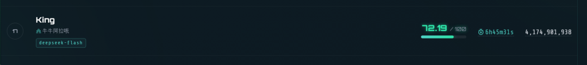
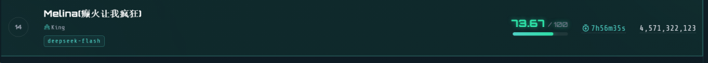
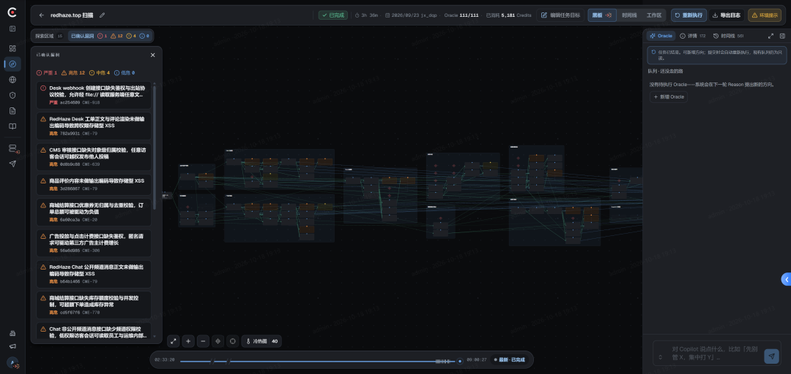
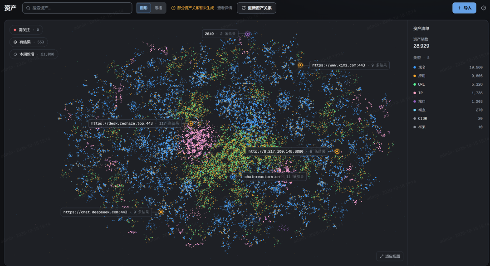
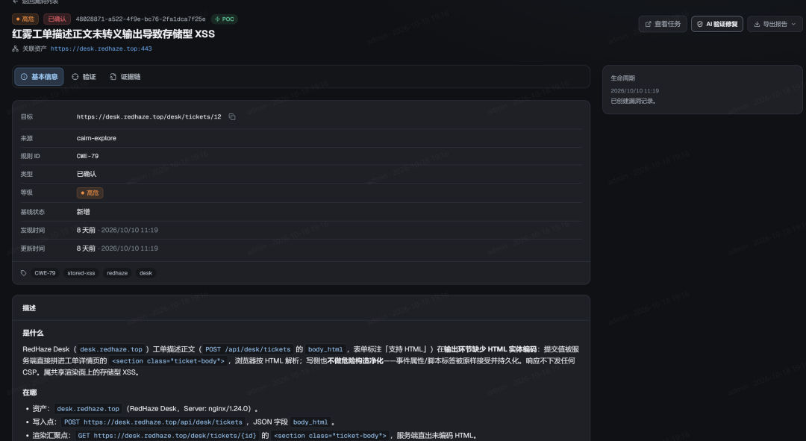
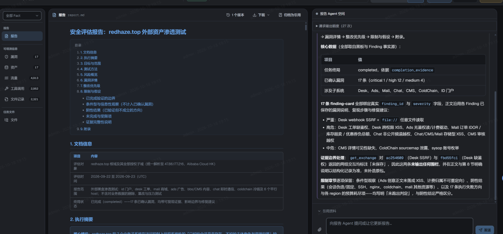
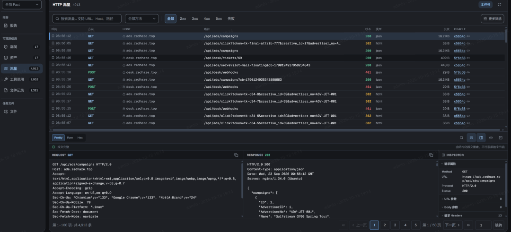

---
date:
  created: 2026-10-20
slug: beyond_blackboard_ai_pentest_architecture
title: 黑板之外-走向更开放的AI渗透架构设计
description: 黑板架构曾被视为 AI 自动化渗透的默认答案。本文从 TCH2、TCH3 的实验出发，重新审视黑板、反馈与 Agent 架构之间的关系。
---

## 黑板架构

黑板架构通常被追溯到 1970 年代卡内基梅隆大学的 Hearsay-II 系统。多个知识源围绕同一块共享黑板工作：读取当前状态，提交新的信息，再由其他知识源继续处理。它不预设一条完整的执行流程，也不要求所有知识源遵循相同的内部逻辑。**系统如何向前推进，取决于黑板上已经留下了什么**。

淚笑把这套范式引入渗透测试，将任务建模为面向目标的状态空间搜索：起点是目标 IP，终点是拿到权限，每次信息收集都是从已知迈向未知的一步。黑板承载这条搜索路径，板上只有三种对象：Fact（已确认的事实）、Intent（待探索的方向）和 Hint（经验提示）。整张图从起点向目标生长。

<!-- more -->

**这套设计不预设攻击流程，不划分角色，也不引入知识库**。所有 Worker 能力相同，仅通过读写黑板间接协作：一个 Worker 写下的 Fact，就是其他 Worker 的出发点。用他的话说：「我没有教它们渗透测试。我只是给了它们一个黑板、一个目标、和一堆工具。」Cairn 的本义是登山者垒起的石堆路标——每个 Fact 都是一块石头，Agent 沿前人留下的路标继续探索，也为后来者垒下新的路标。

后来的 Cairn_Y 沿用这一建模方式，将搜索的全部状态外化为一张只追加的 FGS（Fact-Goal-Step）图：**Fact 描述已确认的事实**，即当前世界状态；Goal 定义搜索的完成条件，并允许动态增删子目标；**Step 描述如何从已有事实产生新事实**，是推动世界状态演化的因果过程。系统的运行分为 Decide 和 Execute 两类活动：Decide 由图上的信息变化触发，负责评估、增删和排序 Step；**Execute 持有改变世界的工具**，负责执行并提交新的 Fact。两者都没有跨会话记忆——FGS 图就是它们共同的外部记忆。

## 从 Intent Logic 说起

今年 1 月，我写过一份从未公开的草稿，叫 **Intent Logic**。出发点是对 Skill 路线的怀疑：给 Agent 预置几十个技能库，本质上是将人的经验固化为清单，简单粗暴的占领了使用者的心智。但我想找一种替代设计——**不预置技能，让意图和状态直接驱动 Agent**。

**核心抽象**

- **State**：事实集合，是对世界当前状态的快照，用自然语言陈述“什么已经成立”。目标也是一个 State；`goal - state` 就是“匮乏”——还缺什么。
- **Intent**：施加在状态上的力，唯一执行语义是 `∇: ϕ → ϕ'`。已满足就跳过；缺什么就补什么。Intent 可串行、并行、分支、回滚，所有算子返回的仍是 Intent，所以能组合成流水线。

核心工作逻辑只有两行：

```python
while (goal - state).facts:    # 匮乏不为空
    state = intent(state)      # 施加力
```

Intent Logic 用 State 表示当前的全部已知信息，例如：

```text
State(facts={
    "资料已收集",
    "数据已分析",
    "正文已撰写",
})
```

通过AI计算 current state 与 goal state 的差距，由 AI 补齐，直到达成目标。**这里的“黑板”就是自然语言事实的集合。**

这份早期草稿已有类似黑板的 State 机制，但最核心的设计是两个 Agent 的运算分工：

- `goal - state` 称为 Reason，负责分析当前状态与目标的差距；
- `intent(state)` 根据当前状态，执行 Reason 生成的意图。

这两类运算又衍生出以下规则，因此得名 Intent Logic：

| 运算规则 | 符号 / 写法 | 一句话理解 |
| --- | --- | --- |
| 满足律 | `()` | 承诺的事实已存在就跳过，保证幂等 |
| 传递律 | `*` | 串行组合：先 A 再 B |
| 合成律 | `a | b` | 并行执行，结果增量合并 |
| 匮乏律 | `-` | `Intent - State` 得到“还差多少力”的残余力 |
| 分支律 | `%` | 按条件真值选分支：`cond % (T, F)` |
| 逆行律 | `~` | 生成回滚操作：`~intent` |

当时希望用形式逻辑构建 Agent 的外部推理回路，将 Skill 中用自然语言描述的逻辑下沉为更底层的推理规则。

**这个架构的核心失败之处在于： 自然语言已经内涵了形式逻辑体系， 外化的形式逻辑推理系统也许是能成立的， 但是一定还没被发现的更加底层作用机制， 我虽然从其中挑选了6条， 还不能凑齐一个完备的意图形式逻辑体系。**

## TCH2：Cybernetics，无法再简化的推理架构

参加 TCH2 时，我没有采用intent-logic架构，主要原因是始终未能解决 Goal 的生成问题：Goal State 需要在没有已知条件时定义交付标准，这个是自相矛盾的， 包含本身就是对未知的预设。（后来我想到，也许根本不必单独生成交付标准，Goal 本身的语义就是标准。）

在探索过程中，我重新设计了一套架构，也就是此前介绍过的 Cybernetics。它仅以反馈（Feedback）构建长链路推理。

一个控制系统通常不需要提前知道完整的运行路径。它只需要知道目标状态，持续观察当前状态，根据两者之间的偏差产生控制信号，再观察行动带来的结果，并据此修正下一步动作。

这套架构的核心逻辑：

- **Reason** 负责判断当前状态和目标之间的差距；
- **Feedback** 是 Reason 给出的下一步行动依据；
- **Action** 读取 Feedback，调用工具并改变外部环境；

因此，它的运行过程可以表示为无限循环：

```text
Action -[Feedback]-> Reason -[Feedback]-> Action -[Feedback]->Reason
```

这里的 Feedback 实际上有两个方向。

1. 1. Reason 产生的 Feedback 面向 Action，告诉它下一步应该尝试什么；
2. 2. Action 产生的 Feedback 面向 Reason，说明刚才的行动在现实中得到了什么结果。前者推动执行，后者修正判断。

简单来说 **Reason 决定下一步，Action 改变现实，Feedback 让系统知道下一步是否需要改变。**

与此同时，淚笑独立设计的 Cairn 采用 Fact-Intent-DAG 黑板架构，取得了 54/54 的满分成绩。

*受赛制影响，大部分题目在前三天就已完成，之后几天，几乎所有人都在手动调试。只看前三天的成绩，我与淚笑的解题能力极为接近。*

从实现上看，Cairn 和 Cybernetics 使用了不同的命名，但描述的是同一类信息流转过程：Cairn 把 Fact 和 Intent 写入黑板，Cybernetics 不写入黑板， 但是通过 Feedback串联 Reason和Action 。两者的核心差别，在于状态是否被显式写入一张共享的图。

这个差异埋下了一颗种子。后来也和淚笑多次讨论过：**渗透测试智能体的有效机制到底是什么？**

因为在Coding时，不管多复杂的工程， Agent 都没有显式的黑板u，但它依然可以依靠上下文和工具返回的结果继续完成任务。这让我第一次认真怀疑，**黑板也许并不是系统能够持续工作的必要条件。**

黑板对人类而言太过自然。我们从课堂开始，就习惯围绕一块共享的黑板学习、记录和协作。这个隐喻几乎无需解释，因此也很容易被移植到 Agent 的设计中。Skill 也是如此：从诞生到流行，很少有人停下来追问(intent-logic诞生于对skill的反思)

从 4 月到 10 月的半年里，我们一直在讨论如何把黑板做得更好，却没有停下来问：

> **黑板是否真的必要？**

## 消融实验

创业初期的各种琐事让我无暇深究，这个念头却始终像一粒埋在干柴中的火星。一次与某大学合作时，我在技术分享中提到了这个想法。当时，一位老师正带着几名研究生设计智能渗透系统。我们一拍即合，共同设计了两个消融实验，由这位老师推进：

1. 1. 去掉黑板的结构约束：移除 JSON 和图结构，改用只追加（append-only）的 Markdown 文件作为黑板。
2. 2. 去掉固定黑板：不约定固定的 Markdown/JSON 文件，Agent 直接将信息写入工作区，后续 Agent 按需自行查找文件。

*实验基于 Cairn，使用 DeepSeek Flash v4.1，在 TCH2 的 tsecbench 上进行。*

约两周后，初步结果出来了。第一个结论是：**黑板的结构不影响效果**。

Markdown、JSON 或精心设计的图结构，对模型而言没有效果上的差别；用于描述结构的提示词和结构本身，反而会消耗更多 token。

这个结论符合我和涙笑的猜想， 也更加显而易见的， 因为任意的结构对模型来说，都不如自然语言描述的因果关系。 **不需要考虑黑板的结构如何设计， 对模型并不基于json/markdown的结构去思考**。

第二个实验更有意思。md 组保留 Markdown 黑板，nomd 组不设固定黑板。以下列出至少一组未在首轮解出的题目：

| 题号 | 备注 | md轮次 | md用时 | nomd轮次 | nomd用时 | 轮次差 | 用时差 | 谁更省 |
| --- | --- | --- | --- | --- | --- | --- | --- | --- |
| a-03 |  | 3 | 100 min | 2 | 99 min | +1 | +1 min | 基本持平 |
| a-05 |  | 2 | 69 min | 4 | 107 min | -2 | -38 min | md更省 |
| a-07 | md首轮解出 | 1 | — | 2 | 59 min | -1 | -59 min | md更省 |
| a-14 |  | 4 | 72 min | 2 | 52 min | +2 | +20 min | nomd更省 |
| a-16 | nomd首轮解出 | 2 | 43 min | 1 | — | +1 | +43 min | nomd更省 |
| a-17 |  | 2 | 86 min | 3 | 98 min | -1 | -12 min | md更省 |
| a-18 | md首轮解出 | 1 | — | 3 | 77 min | -2 | -77 min | md更省 |
| b-01 | 多阶段渗透 | 4 | 91 min | 5 | 128 min | -1 | -37 min | md更省 |
| b-03 | 多阶段渗透 | 3 | 46 min | 5 | 156 min | -2 | -110 min | md更省 |
| c-02 |  | 3 | 23 min | 4 | 83 min | -1 | -60 min | md更省 |
| c-03 | md首轮解出 | 1 | — | 2 | 75 min | -1 | -75 min | md更省 |
| c-05 | nomd首轮解出 | 2 | 64 min | 1 | — | +1 | +64 min | nomd更省 |
| c-09 | nomd首轮解出 | 2 | 97 min | 1 | — | +1 | +97 min | nomd更省 |
| e3-04 |  | 2 | 63 min | 3 | 93 min | -1 | -30 min | md更省 |
| f2-01 |  | 2 | 55 min | 2 | 94 min | 0 | -39 min | md更省 |
| f2-05 | 单线深挖反向案例 | 9 | 195 min | 4 | 75 min | +5 | +120 min | nomd更省 |
| **合计** | **16道机制题** | **43** | **1004 min** | **44** | **1196 min** | **-1** | **-192 min** | **md总耗时少约16%** |

去掉黑板后，解题能力未见明显变化，差异主要体现在耗时：md 组总耗时比 nomd 组少约 16%。目前仍需更多数据验证，但初步结果表明，只靠 Fact-Intent 链式推理也能完成任务，黑板带来的主要收益是效率。

我推测，耗时差异主要来自每次 Agent 启动时的探索阶段：执行前，它需要先查找并读取当前意图所需的信息。

这与我的猜想一致：简单题目中，黑板没有机会发挥作用；复杂题目中，黑板带来的效率上的正收益与长链路的信息污染会抵消。

**黑板本质是仪表盘， 而非发动机**，去掉黑板之后，也同时解决了长链路任务中的信息污染问题，反而能做到1B甚至2B的任务持续产出。 就像是coding一样， AI接手庞大的代码仓库， 并非是通过agent.md描述了所有的关键信息， 而是通过explorer自行组织需要的上下文。

### TCH3上的再次验证

由 @无处 主导的两套架构， 这套架构没有 fact-intent链式推理， 只有goal + 黑板/无黑板， 以及
一些无处自行设计的机制。 其他机制先不展开。

无处使用goal+黑板得到了第一次成绩：



删除了黑板之后的成绩：



无黑板成绩上有一点优化，但是token也略多， 在正常的误差之内， 不过其成绩接近也可以说明， **黑板并非有效因素**。

> 顺便恭喜一下我们团队中的四位年轻的实习生， 在TCH3中设计了7套新的架构。 取得了
>
> - • 5 @chaomixian
> - • 14 @无处
>
>   • 17 @无处
>
>   • 19 @timmy
>
>   • 25 @timmy
>
>   • 35 @chaomixian
>
>   • 84 @浅兮

## CYBER 产品的架构演进

CYBER 脱胎于 Cairn，也保留了不少经典设计。

CYBER 从设计之初强调自主执行，能够在无人介入的情况下完成任务。也是可能目前市面上唯一能完成超长链路的渗透测试，甚至进行顶级产品。

我们先做减法，去掉 Hint。这个概念受到的质疑最多，本质上服务于人类介入，而我们有更好的方式实现这一点。

Fact 和 Intent 则被保留，并经过彻底重构。为支持人机交互，我们设计了一个 Intent 状态机，包含三种状态：

- **Oracle**：等待执行的意图；人类通过Oracle可以控制下一步行动， 作为Hint的代替
- **Intent**：正在执行的意图；
- **Probe**：已经执行完成

针对超长流程的渗透测试任务（单个任务超过 1B token），实现了冷热图算法，在不引入额外概念的前提下，解决上下文过载和信息误导问题。

还有无数的新优化， 可以申请我们的平台试用体验。

下一个版本中，**黑板不会再作为 Agent 的主要推理接口存在**。它仍然会保留，但主要用于人类查看任务状态、回放执行过程和进行必要的干预。Agent 内部的状态流转和决策方式，会在这个基础上持续重构。

这段时间，我们在**可观测性、可解释性、进攻性基础设施和 Agent 底层架构**上都做了较大的重构。CYBER 目前还不是最终形态，但它已经不再只是 Cairn 的工程化版本，而是对 AI 自动化渗透领域的一次重塑。

AI 带来的生产力，让我们能将天马行空的想象迅速落地为产品。欢迎试用，也请期待 CYBER 2.0。

CYBER 平台截图：



黑板架构



赛博空间拓扑表达协议



自解释的漏洞报告

可交互的自然语言报告



可观测性

**至少在今天，CYBER 是对 AI 自动化渗透测试给出的最好答案。**

> CYBER 2.0 中（预计今年11月发布）， 我们正式放弃了黑板架构作为推理引擎，与此同时找到了更多能用于不同场景的下一代架构， 并且部分架构已经在realworld和TCH3中得到验证。

## 后记

本文写于 TCH3 之前，为避免影响大家的思路，选择在赛后发布。

过去六个月，开源社区在智能渗透上似乎形成了共识，共识之下也隐藏着危机。在 TCH3 赛前直播中，我和淚笑聊到，我们都有了下一代架构的设想，都不再满足于沿着现成的路径继续优化。回顾这六个月，很少有人去触碰那个看起来理所当然的前提。

**黑板之外，还有多少被默认、却从未真正验证过的东西？**

> 体验CYBER · AI Native Hacker Swarm产品可以关注 链式反应.ai 账号
>
> [顶级黑客团队出品 - AI时代赛博自救指南](https://mp.weixin.qq.com/s?__biz=MzY4NTQzNzEwNQ==&mid=2247483776&idx=1&sn=2eb198624eae37ac6886924651e555cc&scene=21#wechat_redirect)

---

原文：[黑板之外-走向更开放的AI渗透架构设计](https://mp.weixin.qq.com/s/bmQmIMtiPANCC8hEwmO0ew)

作者：M09ic · 发布日期：2026-10-20
